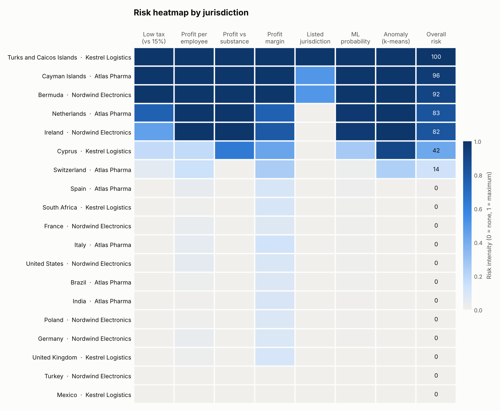

# TaxRiskScan: AI System for Detecting High-Risk Tax Jurisdictions

[](https://github.com/AlirezaMahdavishirkharkolaei/Tax_Risk_AI/actions/workflows/tests.yml)


TaxRiskScan analyses multinational company data in Country-by-Country Reporting (CbCR) format. It flags jurisdictions that show signs of tax avoidance, low taxation or aggressive profit shifting. It combines **transparent legal-economic rules**, a **logistic-regression classifier** and **k-means anomaly detection** into a single 0–100 risk score. Every flag comes with a plain-language reason and a recommended review step.

*Started as a project for the Building AI course (Reaktor & University of Helsinki), now a working tool.*



> **Risk indicators, not legal conclusions.** A high score means "look closer", not "non-compliant". Low effective tax rates and high profits can have legitimate explanations, such as loss relief, incentives, timing differences or genuine returns on IP. Every flag needs human review.

## Background

Multinational groups operate across many countries with different tax rates and reporting obligations. Regulators (OECD, EU, UN) have introduced frameworks such as **Pillar Two (GloBE, 15% global minimum tax)** and **Country-by-Country Reporting (BEPS Action 13)**, but interpreting the data is still hard.

Problems addressed:

* detecting unusual profit patterns
* manual analysis of CbCR spreadsheets
* identifying jurisdictions with very low effective tax rates
* deciding where further audit or documentation is needed

The aim is to make tax transparency more accessible and to help reduce illicit profit shifting, while also supporting companies that want to comply proactively.

## Quick start

```bash
git clone https://github.com/AlirezaMahdavishirkharkolaei/Tax_Risk_AI.git
cd Tax_Risk_AI
pip install -e ".[app,dev]"        # or: pip install -r requirements.txt

taxriskscan analyze data/sample_cbcr.csv --out results/   # command line
streamlit run app.py                                       # web dashboard
pytest                                                     # 19 tests
```

`python Tax_Risk_AI.py` still works. It analyses the bundled sample and writes the report to `results/`.

## How is it used?

1. **Provide a dataset**, one row per entity or jurisdiction (CSV upload in the dashboard, or a file path on the command line):

   | column | required | meaning |
   |---|---|---|
   | `jurisdiction` | ✓ | country / territory |
   | `revenue` | ✓ | turnover |
   | `profit_before_tax` | ✓ | profit (loss) before income tax |
   | `tax_paid` | ✓ | income tax paid |
   | `employees` | ✓ | number of employees |
   | `group` | | multinational group, used for within-group comparisons |
   | `tangible_assets` | | tangible assets other than cash |

   Common alternative headers (`country`, `turnover`, `profit`, `tax`, …) are recognised. Run `taxriskscan sample` to print a template.

2. **The system computes indicators**: effective tax rate (ETR), profit per employee, profit margin, and each entity's share of group profit versus its share of group staff and assets.

3. **Three engines score each entity**:
   * **Rules**: ETR below 10% or below the 15% GloBE minimum, profit with no employees, very high profit per employee, profit far exceeding economic substance, very high margins, EU Annex I listing, zero-tax jurisdictions.
   * **Logistic regression**: the probability that the entity looks like a profit-shifting hub.
   * **k-means**: how far the entity sits from clusters of ordinary entities (in the risky direction only).

4. **You receive**:
   * a **heatmap** of risk indicators per jurisdiction, plus a risk-score chart
   * a **summary table** (`risk_summary.csv`)
   * an **HTML audit report** with findings and **recommendations for documentation or review**, e.g. *"Run a GloBE ETR calculation and assess exposure to a top-up tax (QDMTT / IIR / UTPR)"*


Primary users: auditors, financial analysts, tax officers and compliance teams.

## Data sources and AI methods

### Data

* **EU list of non-cooperative jurisdictions (Annex I)**, as revised on 9 October 2026, in [`taxriskscan/jurisdictions.py`](taxriskscan/jurisdictions.py)
* A list of jurisdictions with **no or nominal corporate income tax** (a weak indicator, since several now apply a 15% domestic minimum tax to large groups)
* `data/sample_cbcr.csv`: three fictional groups for demonstration
* `taxriskscan/data/training_cbcr.csv`: **synthetic** labelled reference data (see below)

Public CbCR statistics from the OECD and the EU Tax Observatory are published only in aggregate, without entity-level labels. The classifier is therefore trained on a reproducible simulation ([`scripts/generate_synthetic_data.py`](scripts/generate_synthetic_data.py)). In that simulation, labels come from the simulated scenario (ordinary entity vs. profit-shifting hub), **not** from the rule engine. The classes are designed to overlap: some ordinary entities have legitimately low ETRs or high margins, and some hubs have real substance. With real labelled cases (e.g. past audit outcomes), retrain with:

```bash
taxriskscan train my_cases.csv                         # diagnostics: AUC + coefficients
taxriskscan analyze data.csv --train my_cases.csv      # score with your own model
```

### AI methods

| method | role | where |
|---|---|---|
| Rule-based scoring | transparent, explainable flags with reasons and recommendations | `rules.py` |
| Logistic regression | risk classification (group-wise cross-validated ROC AUC ≈ 0.99 on synthetic data) | `model.py` |
| k-means clustering | anomaly detection relative to ordinary entities | `model.py` |
| Preprocessing & normalisation | ETR handling for losses, log scaling, standardisation | `metrics.py` |

**Final score** = 50% rules + 30% classifier + 20% anomaly. Levels: High ≥ 60, Medium ≥ 35. All thresholds and weights are in [`taxriskscan/config.py`](taxriskscan/config.py).

## Project structure

```
taxriskscan/
  metrics.py        load & validate CSV, compute indicators
  rules.py          rule engine (reasons + recommendations)
  model.py          logistic regression + k-means
  pipeline.py       blends everything into the risk score
  report.py         heatmap, charts, HTML report
  jurisdictions.py  EU Annex I and zero-tax lists
  config.py         thresholds and weights
  cli.py            command-line interface
app.py              Streamlit dashboard
scripts/            synthetic data generator
tests/              pytest suite
```

## Challenges and limitations

* Produces risk indicators only. It does not give legal conclusions.
* Results depend on data quality, and CbCR "tax paid" is cash-based, which can differ from a GloBE ETR.
* Anomalies may be legitimate and require human review.
* Data availability differs across jurisdictions.
* The bundled classifier is trained on synthetic data. Treat its probability as illustrative until it is retrained on real cases.
* The jurisdiction lists change twice a year and must be kept up to date.

## What next?

* Neural-network-based risk detection
* Automatic updates of the EU list and other regulatory sources
* Full Pillar Two simulation (IIR, UTPR, QDMTT, substance-based income exclusion)
* Import of the OECD CbCR XML schema
* PDF export of the audit report

## Acknowledgments

* Building AI course by Reaktor & University of Helsinki
* OECD and EU Tax Observatory (open data)
* Academic literature on tax transparency and profit shifting

## License

[MIT](LICENSE)
