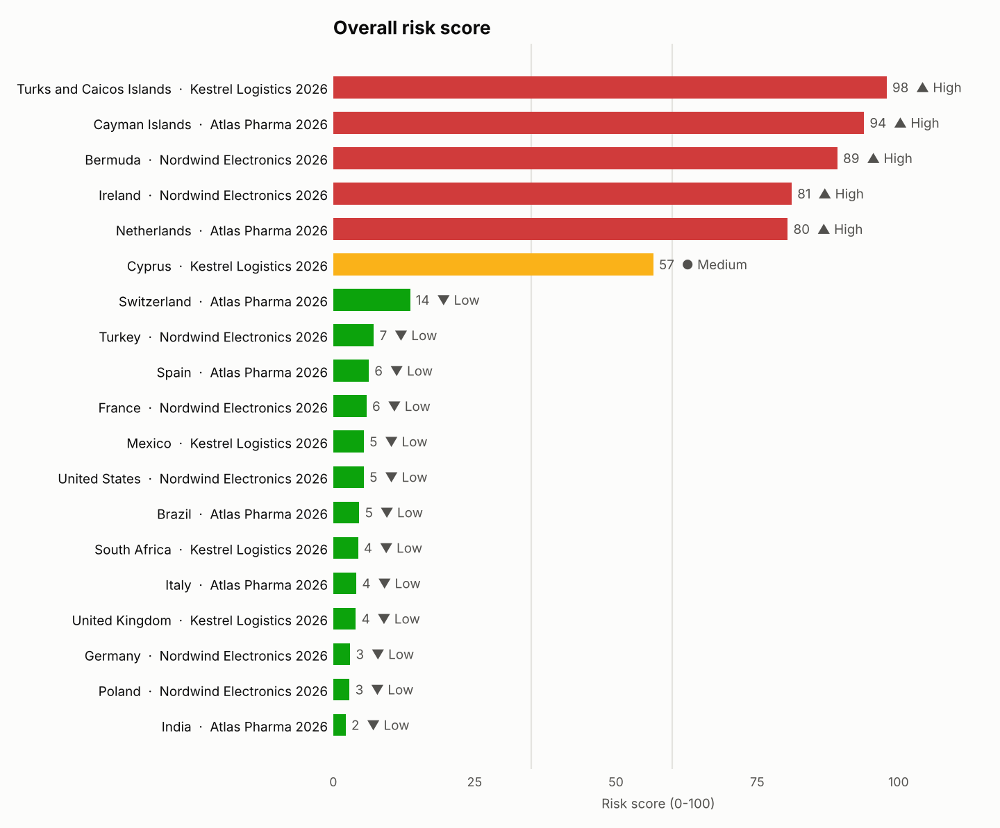

# TaxRiskScan: AI System for Detecting High-Risk Tax Jurisdictions

[](https://github.com/AlirezaMahdavishirkharkolaei/Tax_Risk_AI/actions/workflows/tests.yml)


TaxRiskScan analyses multinational company data in Country-by-Country Reporting (CbCR) format. It flags jurisdictions that show signs of tax avoidance, low taxation or aggressive profit shifting, and it screens each jurisdiction for **Pillar Two** global minimum tax exposure.

It combines three things:

* **transparent legal-economic rules**, each linked to its **legal basis** (EU directives, OECD guidelines)
* a **logistic-regression classifier trained on real public CbCRs** from ~100 multinationals
* **k-means anomaly detection**

Every flag comes with a plain-language reason, a recommended review step and the provisions to consult.

*Started as a project for the Building AI course (Reaktor & University of Helsinki), now a working tool.*

## Who it is for

| | How TaxRiskScan helps |
|---|---|
| **Tax administrations** | Rank CbC reports received under DAC4 / BEPS Action 13 for audit selection, with the legal basis attached to every flag |
| **Audit and advisory firms** | Pre-screen clients' Pillar Two exposure and Transitional CbCR Safe Harbour position |
| **Corporate tax teams** | Run the same tests on the group's own CbCR before filing or before public CbCR disclosure |
| **Universities** | Teach international tax with real data: research mode, a browser app that needs no installation, and documented methods |
| **Researchers and NGOs** | Reproducible, citable analysis of public CbCRs (`taxriskscan research`, CITATION.cff, data hashes) |

Documentation: [Methodology](docs/methodology.md) · [Organisation guide](docs/for-organisations.md) · [Model card](MODEL_CARD.md) · [Data sources](DATA_SOURCES.md) · [Changelog](CHANGELOG.md)


> **Risk indicators, not legal conclusions.** A high score means "look closer", not "non-compliant". Low effective tax rates and high profits can have legitimate explanations, such as loss relief, incentives, timing differences or genuine returns on IP. Every flag needs human review.

## What it does

| | |
|---|---|
| **Risk scoring** | A 0–100 score per entity: 50% rules + 30% ML probability + 20% anomaly |
| **Real-data model** | Trained on the EU Tax Observatory's Public CbCR database (5,004 rows, 96 groups, 2015–2023) |
| **Explainability** | For each entity, which features pushed the model's probability up |
| **Pillar Two** | Transitional CbCR Safe Harbour tests (de minimis, simplified ETR, routine profits) and an estimated top-up tax per jurisdiction |
| **Legal basis** | Each flag linked to ATAD, the Pillar Two Directive, DAC6, DAC4, the public CbCR Directive, the OECD TPG and BEPS Actions |
| **Benchmarks** | Each jurisdiction's aggregate ETR from OECD CbCR statistics, as context |
| **Inputs** | CSV, or **OECD CbC XML** (schema v2.0) |
| **Outputs** | Heatmap, score chart, summary CSV, Pillar Two CSV, and a self-contained HTML audit report (print to PDF) |
| **Interfaces** | Command line (batch, JSON), REST API with Docker, Streamlit dashboard, and a browser-only web app (Pyodide) |
| **Organisation settings** | TOML configuration: thresholds, weights, risk levels, currency conversion, own watchlist |
| **Data quality** | Warnings for aggregate rows, unknown jurisdictions, tax above profit, duplicates and missing fields |
| **Audit trail** | Input SHA-256, configuration fingerprint, model-data hash and library versions in every report |
| **Own models** | Train on your own audit outcomes, then save and reuse the model with its model card |
| **Research mode** | Haven shares of profit, employees and tax by year; ETRs; leading havens; sectors; Pillar Two exposure; out-of-sample validation |

## Quick start

```bash
git clone https://github.com/AlirezaMahdavishirkharkolaei/Tax_Risk_AI.git
cd Tax_Risk_AI
pip install -e ".[app,dev]"        # or: pip install -r requirements.txt

taxriskscan analyze data/sample_cbcr.csv --out results/   # CSV
taxriskscan analyze data/sample_cbc.xml --out results/    # OECD CbC XML
taxriskscan analyze filings/*.csv --config org.toml --json # batch, organisation settings, JSON output
taxriskscan train cases.csv --save model.joblib           # your own labelled cases
taxriskscan research --out research/                      # research brief on public CbCRs
taxriskscan serve                                         # REST API at http://127.0.0.1:8000/docs
streamlit run app.py                                      # web dashboard
pytest                                                    # 48 tests
```

`python Tax_Risk_AI.py` still works. It analyses the bundled sample and writes the report to `results/`.

### Web app (runs in the browser)

`web/` holds a static version of TaxRiskScan that runs the real Python package in the browser with [Pyodide](https://pyodide.org). There is no server, and uploaded files never leave the user's machine.

```bash
python scripts/build_web.py              # builds web/dist/
python -m http.server -d web/dist 8000   # open http://localhost:8000
```

To publish it on **GitHub Pages**, go to *Settings → Pages → Source: GitHub Actions*. The `pages.yml` workflow then deploys it on every push to `main`, at `https://alirezamahdavishirkharkolaei.github.io/Tax_Risk_AI/`.

### REST API and Docker (self-hosted)

```bash
docker compose up -d                                      # http://localhost:8000/docs
curl -H "X-API-Key: change-me" -F file=@data/sample_cbc.xml http://localhost:8000/analyze
```

Endpoints include `/analyze` (CSV or XML upload), `/analyze/json`, `/report` (HTML), `/pillar2` and `/model`. Configuration is done with environment variables. See the [organisation guide](docs/for-organisations.md).

### Deploy the Streamlit dashboard (free)

1. Push the repository to GitHub.
2. On [share.streamlit.io](https://share.streamlit.io), choose **New app**, select this repository, and set the main file to `app.py`.
3. `requirements.txt` and `.streamlit/config.toml` are already set up.

## Input data

One row per entity or jurisdiction (CbCR Table 1):

| column | required | meaning |
|---|---|---|
| `jurisdiction` | ✓ | country / territory |
| `revenue` | ✓ | total revenues |
| `profit_before_tax` | ✓ | profit (loss) before income tax |
| `tax_paid` / `tax_accrued` | one of them | income tax paid (cash) / current tax accrued. ETR uses the accrued figure when given |
| `employees` | ✓ | number of employees |
| `group`, `year` | | multinational group and fiscal year. Shares are computed per group and year |
| `tangible_assets` | | tangible assets other than cash. Used for substance and the SBIE |
| `payroll_costs` | | needed for a complete Pillar Two routine-profits test |

Common alternative headers (`country`, `turnover`, `profit`, …) are recognised. Run `taxriskscan sample` to print a template.

## Real training data

The classifier is trained on the **EU Tax Observatory's Public Country-by-Country Reports database**: CbCRs that ~100 large multinationals published voluntarily, standardised and converted to EUR. The label is whether the jurisdiction is classified as a **tax haven** in that database.

Jurisdiction names and lists are deliberately **not** model inputs. The model only sees currency-free financial ratios: low-tax gap, profit and revenue per employee relative to the group, margin, profit share vs. share of staff and assets, and size. So it learns what a *haven-like financial profile* looks like, and can flag one in any jurisdiction.

| | |
|---|---|
| Training rows | 5,004 jurisdictions · 96 multinationals · 237 reports · 2015–2023 |
| Positive (tax-haven) rows | 811 |
| Validation | 5-fold **group-wise** cross-validation (a multinational never appears in both train and test) |
| ROC AUC | **0.73** |

The AUC is modest by design. The label is noisy, since many affiliates in Belgium, the Netherlands or Singapore are real operating businesses. That is exactly why the ML signal is blended with transparent rules rather than used alone. On the bundled synthetic data the same model reaches 0.99, which shows how optimistic synthetic benchmarks are.

Use your own labelled cases (e.g. past audit outcomes):

```bash
taxriskscan train my_cases.csv
taxriskscan analyze data.csv --train my_cases.csv
```

Sources, citations and terms of use are in **[DATA_SOURCES.md](DATA_SOURCES.md)**. The real training data is free for **non-commercial** use with citation.

## Pillar Two screening

For each group, year and jurisdiction (entities blended, as the GloBE rules require):

* **De minimis test:** CbCR revenue < €10m and profit before tax < €1m
* **Simplified ETR test:** tax / profit ≥ transition rate (15% for 2023–24, 16% for 2025, 17% for 2026–27)
* **Routine profits test:** profit ≤ substance-based income exclusion (SBIE), using the transitional payroll and tangible-asset percentages
* **Estimated top-up tax** = (15% − ETR) × (profit − SBIE) where the safe harbour does not apply

This is a screening estimate from CbCR figures, not a full GloBE computation. If payroll costs are missing, the routine-profits test may be *undetermined* and the top-up estimate becomes an upper bound.



## Research mode

```bash
taxriskscan research --out research/
```

This analyses the bundled public CbCR data, or any CSV with a `label` column, and writes a research brief with CSV tables and charts. On the bundled data (96 multinationals, 237 reports):

| | |
|---|---|
| Profit booked in tax havens | 10.7% (vs. 5.1% of employees) |
| Profit-weighted ETR | 6–11% in havens vs. 21–30% elsewhere, every year |
| Leading havens by profit booked | Netherlands, Singapore, Switzerland, Luxembourg, Belgium |
| Risk score out of sample | ROC AUC 0.71; 11% of haven rows score *High* vs. 2% of other rows |

Public CbCRs are published voluntarily, so the sample is selective and changes over time. These are descriptive statistics, not estimates of revenue loss.

## Licensing and editions

The **code is MIT** and free for any use. The **bundled real-data model** follows the EU Tax Observatory's terms: non-commercial use with citation.

* **Commercial deployments:** set `TAXRISKSCAN_TRAINING=synthetic` or train on your own cases.
* Details are in the [organisation guide](docs/for-organisations.md#licensing-pick-the-right-model).

## Citation

If you use TaxRiskScan in research, cite it via [CITATION.cff](CITATION.cff) (GitHub's "Cite this repository" button), and cite the data sources listed in [DATA_SOURCES.md](DATA_SOURCES.md).

## Methods

| method | role | where |
|---|---|---|
| Rule-based scoring | explainable flags with reasons, recommendations and legal basis | `rules.py`, `legal.py` |
| Logistic regression (spline features) | probability of a haven-like profile, trained on real CbCRs | `model.py` |
| k-means clustering | anomaly score relative to ordinary entities, counting deviations in the risky direction only | `model.py` |
| Feature contributions | per-entity explanation of the ML probability | `model.py` |
| Pillar Two engine | safe-harbour tests, SBIE, top-up estimate | `pillar2.py` |

All thresholds and weights are in [`taxriskscan/config.py`](taxriskscan/config.py).

## Project structure

```
taxriskscan/
  metrics.py        load & validate data, indicators, ML features
  rules.py          rule engine (reasons + recommendations)
  legal.py          legal basis for each rule
  model.py          logistic regression, k-means, explanations
  pillar2.py        Transitional CbCR Safe Harbour + top-up estimate
  benchmarks.py     OECD 2016 jurisdiction benchmarks
  cbcxml.py         OECD CbC XML import
  pipeline.py       puts it all together (+ JSON export, audit metadata)
  quality.py        data-quality checks
  research.py       dataset-level research mode
  api.py            REST API (FastAPI)
  config.py         defaults + TOML configuration
  report.py         heatmap, charts, HTML report
  jurisdictions.py  EU Annex I and zero-tax lists
  data/             real training data, OECD benchmarks, synthetic data, example_config.toml
app.py              Streamlit dashboard
web/                browser web app (Pyodide) + bridge
scripts/            rebuild real data, generate synthetic data
tests/              pytest suite
```

## Challenges and limitations

* Produces risk indicators only. It does not give legal conclusions.
* Public CbCRs come from multinationals that chose to publish, so they are not a random sample. The tax-haven label is a proxy for risk, not a finding of abuse.
* CbCR "tax" is not GloBE adjusted covered taxes, and CbCR profit is not GloBE income.
* Pillar Two thresholds assume amounts in EUR.
* The OECD benchmarks are from 2016, and the jurisdiction lists change twice a year.
* Anomalies may be legitimate and require human review.

## What next?

* Newer OECD aggregated CbCR years and EU public CbCR filings (Directive 2021/2101) as training data
* QDMTT / IIR / UTPR allocation of the top-up tax
* AI-written executive summary of the audit report
* Automatic updates of the EU list
* Multi-year trend view per group
* Zenodo DOI for each release

## Acknowledgments

* Building AI course by Reaktor & University of Helsinki
* EU Tax Observatory (Public CbCR database) and Data For Good
* OECD Corporate Tax Statistics
* Academic literature on tax transparency and profit shifting

## License

Code: [MIT](LICENSE). Bundled data: see [DATA_SOURCES.md](DATA_SOURCES.md).
